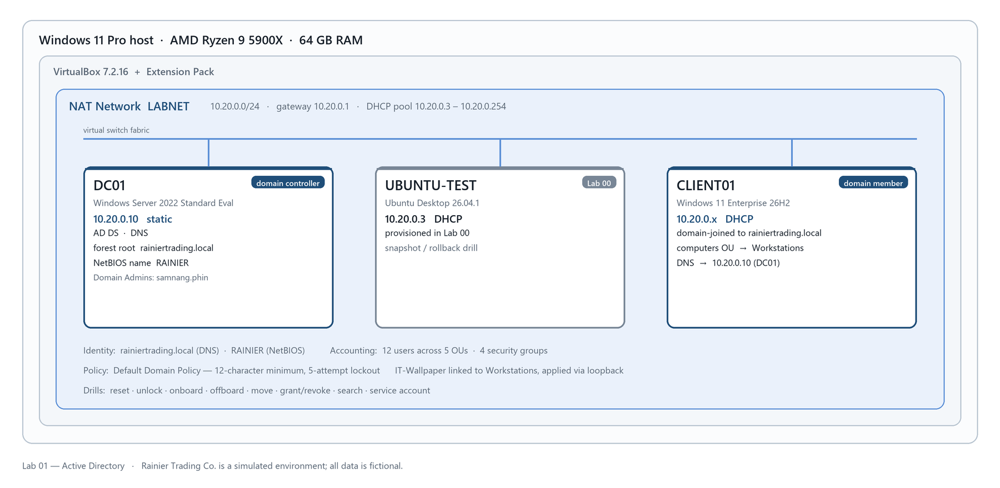

# Lab 01 — Active Directory: The Company ID Office

**Status:** 🔨 Hands-on complete — artifacts staged in this folder, commit pending
**Started:** 2026-11-22 · **Completed:** 2026-11-27 · **Time invested:** ~14 hours
**Environment:** VirtualBox 7.2.16 on Windows 11 Pro · `DC01`: Windows Server 2022 Standard Evaluation (Desktop Experience), 4 GB RAM, 2 vCPU, 60 GB disk · `CLIENT01`: Windows 11 Enterprise 26H2 Evaluation, 4 GB RAM, 2 vCPU, 80 GB disk, EFI + Secure Boot + TPM 2.0 · Domain `rainiertrading.local` · Lab network `LABNET` 10.20.0.0/24

## Objective

Built the domain controller for Rainier Trading Co. — the service that issues and enforces every identity in the company — then ran the day-to-day work of a tier-1 help desk against it: creating accounts, resetting passwords, clearing lockouts, onboarding a hire, disabling a leaver, moving someone between departments, and enforcing policy across the fleet through Group Policy.

The point of the lab is the verbs. Job postings say *"perform account adds, moves, and changes in Active Directory"*; every one of those verbs was performed here, on a domain that a Windows 11 client actually authenticates against.

## Architecture



```text
Windows 11 Pro host (AMD Ryzen 9 5900X, 64 GB RAM)
└── VirtualBox 7.2.16
    └── NAT Network: LABNET  10.20.0.0/24   (gateway 10.20.0.1 · DHCP .3–.254)
        ├── DC01 — Windows Server 2022 Standard Evaluation — 10.20.0.10 (static)
        │   ├── AD DS forest root: rainiertrading.local   (NetBIOS name: RAINIER)
        │   ├── DNS server for the domain, forwarder 1.1.1.1
        │   └── Roles installed: AD DS, DNS
        ├── UBUNTU-TEST — Ubuntu Desktop 26.04.1 — 10.20.0.3   (built in Lab 00)
        └── CLIENT01 — Windows 11 Enterprise 26H2 — 10.20.0.x (DHCP), domain-joined
```

One domain answers to two names, which is the detail that trips people up when they start reading AD error messages:

| Name | Value | Where it is used |
|---|---|---|
| DNS / FQDN | `rainiertrading.local` | domain joins, DNS records, Group Policy paths |
| NetBIOS | `RAINIER` | the legacy `DOMAIN\user` logon format — what `whoami` prints |

### Directory design

```text
rainiertrading.local
├── Employees
│   ├── Sales         (3 people — mara.chen moved to Support in drill 5)
│   ├── Operations    (2 people — dev.patel disabled and moved to Leavers)
│   └── Support       (4 people — jordan.lee onboarded in drill 3, mara.chen moved in during drill 5)
├── IT                (2 users — samnang.phin is the named admin)
├── Managers          (1 user)
├── ServiceAccounts   (svc-backup)
├── Leavers           (disabled accounts)
├── Workstations      (CLIENT01)
└── Servers
```

Groups: `gg-Sales` (3), `gg-Support` (4), `gg-Managers` (1), `gg-Helpdesk` (2). Thirteen people in the directory, plus one service account.

The hierarchy exists to be targeted: a policy linked to `Employees` reaches everyone in it, and a workstation sitting in `Workstations` can be governed without touching anyone else's machine.

## What I did

1. Deployed `DC01` as a Windows Server 2022 Standard Evaluation VM on `LABNET` — Desktop Experience, 4096 MB RAM, 2 vCPU, 60 GB dynamically allocated disk.
2. Assigned a static address of `10.20.0.10/24` with gateway `10.20.0.1` and renamed the host to `DC01`, so the domain controller is findable at a fixed address rather than whatever DHCP last handed out.
3. Installed the **Active Directory Domain Services** role and promoted the server to the forest root of a new domain, `rainiertrading.local`, with NetBIOS name `RAINIER` and a DSRM recovery password held in a password manager.
   Verified with `Get-ADDomain` / `Get-ADForest`: `DNSRoot rainiertrading.local`, `NetBIOSName RAINIER`, `DistinguishedName DC=rainiertrading,DC=local`.
4. Took a powered-off snapshot, `DC01 - promoted, clean`, before any further configuration — a working domain controller is the baseline every later mistake gets rolled back to.
5. Pointed the server's own DNS client at itself (`10.20.0.10`), removed a stray IPv6 loopback entry, and added `1.1.1.1` as a forwarder so internal names resolve locally while external names resolve upstream.
   Verified: `ping -4 dc01.rainiertrading.local` answers from `10.20.0.10`; `nslookup dc01.rainiertrading.local` returns `10.20.0.10`.
6. Built the organisational hierarchy in **Active Directory Users and Computers** — six top-level OUs, with `Sales`, `Operations` and `Support` nested under `Employees`.
   ``
7. Provisioned twelve user accounts using a consistent `first.last` logon convention, each placed in the OU matching its department, with `samnang.phin` created as the named administrative account rather than working day-to-day as the built-in `Administrator`.
8. Created four security groups in their departmental OUs and populated them by role, then granted `samnang.phin` membership of **Domain Admins** and continued all administrative work from that named account.
   Verified: `whoami /groups | findstr /i "Domain Admins"` → `RAINIER\Domain Admins S-1-5-21-…-512`.
9. Set account policy through **Default Domain Policy**: 12-character minimum password length, complexity enabled, lockout after 5 invalid attempts for 15 minutes.
   ``
   ``
   Verified: `net accounts` on DC01 → `Minimum password length: 12`, `Lockout threshold: 5`, `Lockout duration: 15`.
10. Built a Windows 11 client, `CLIENT01`, with EFI firmware, Secure Boot and TPM 2.0, gave it DC01 as its DNS server, and joined it to the domain in a single rename-and-join step.
    ``
11. Linked an `IT-Wallpaper` GPO to the **Workstations** OU and enabled loopback processing so its user-side setting reaches whoever logs on to a company machine.
    ``
    ``
12. Ran the eight help-desk drills: password reset, account unlock, new-hire onboarding, leaver offboarding, inter-department move, access grant and revoke, fast account search, and a service account.
    ``
    ``

## Problems I hit and how I fixed them

### A VirtualBox NAT network has no room outside its DHCP pool

- **Symptom:** the plan called for a static server address chosen from outside the DHCP range, so the domain controller could never collide with a lease. `LABNET` hands out `10.20.0.3`–`10.20.0.254` — the entire usable subnet apart from the gateway and the DHCP server itself.
- **Diagnosis:** checked the pool with `VBoxManage list dhcpservers`, then checked whether it could be narrowed. `VBoxManage natnetwork modify` exposes no lower/upper IP option; VirtualBox fixes a NAT network's pool to `.3`–`.254` of its subnet and only a host-only network lets you move it.
- **Fix:** reserved `10.20.0.10` by convention instead — the same idea a real DHCP server implements with an exclusion range. Lease behaviour confirmed beforehand: the other guests sat at `.3`, and DHCP allocates upward from the bottom, so `.10` was provably free.
- **Lesson:** when a platform won't let you follow the textbook, document the constraint and the reasoning rather than quietly doing something unsafe. "It's in the pool but nothing else can take it" is defensible; "I didn't notice" is not.

### `whoami` answered `rainier\administrator`, not `rainiertrading\administrator`

- **Symptom:** the domain was built as `rainiertrading.local`, but `whoami` reported `rainier\administrator`, which reads like the wrong domain was created.
- **Diagnosis:** `whoami /upn` returned `administrator@rainiertrading.local`, and `Get-ADDomain` reported `DNSRoot rainiertrading.local` with `NetBIOSName RAINIER`. The forest was correct; `whoami` prints the NetBIOS form by design, because `DOMAIN\user` is the pre-2000 identity format.
- **Fix:** no change to the environment. The verification method was corrected — use `whoami /upn`, `Get-ADDomain`, and `nslookup` when the question is about the DNS domain.
- **Lesson:** in AD, "the domain name" is ambiguous. Know which of the two names a tool is showing before concluding something is misconfigured.

### The GPO reported as applied and the desktop never changed

- **Symptom:** after linking `IT-Wallpaper`, `gpresult /r` listed it under **Applied Group Policy Objects** for `CN=Mara Chen,OU=Sales,OU=Employees` — and the wallpaper stayed black.
- **Diagnosis:** three separate questions were hiding behind one symptom. (1) Was the GPO applied? `gpresult` said yes. (2) Was the setting written? `reg query "HKCU\Software\Microsoft\Windows\CurrentVersion\Policies\System" /v Wallpaper` returned the correct path. (3) Did that path exist? `Test-Path C:\Users\Public\Pictures\rainier.jpg` returned **False** — even though the image was visible in File Explorer, because Explorer hides file extensions by default and the real filename differed.
- **Fix:** a separate problem had stacked underneath. The wallpaper is a *user* setting, and the GPO was linked to an OU full of *computers*; user settings follow where the user object lives, so it would have applied to nobody. Enabled **Configure user Group Policy loopback processing mode** (Computer Configuration → Administrative Templates → System → Group Policy, mode Merge) inside the same GPO. Then copied a valid JPEG to the exact path the policy names and signed out and back in.
- **Lesson:** "the GPO applied" is not evidence that the change worked. Test the three layers separately — applied, written, reachable — and turn on file extensions before believing a filename.

### `nslookup` reported `Server: UnKnown` and `ping` answered an IPv6 link-local address

- **Symptom:** after pointing DNS at the domain controller, `nslookup dc01.rainiertrading.local` resolved the right address but named its server `UnKnown` at `::1`, and `ping` replied from `fe80::…` instead of `10.20.0.10`.
- **Diagnosis:** the adapter's DNS server list contained `::1` as well as `10.20.0.10`, so the resolver queried IPv6 loopback first. `UnKnown` is a separate matter — `nslookup` reverse-looks-up its own server address, and no reverse lookup zone exists in a fresh forest.
- **Fix:** removed `::1` from the IPv6 properties of the adapter, leaving `10.20.0.10` as the only resolver; `ping -4` then answered from IPv4. The missing PTR record is expected and harmless — creating a reverse lookup zone for `10.20.0.x` is on the list for the networking lab.
- **Lesson:** a domain controller should point at its own real address, not loopback — and "it resolves" is not the same as "it resolves over the path you think it does."

## Evidence

- [`screenshots/ou-tree.png`](screenshots/ou-tree.png) — the organisational hierarchy with users placed in their departments
- [`screenshots/client01-domain-login.png`](screenshots/client01-domain-login.png) — domain logon on CLIENT01 as `RAINIER\mara.chen`
- [`screenshots/client01-domain-whoami.png`](screenshots/client01-domain-whoami.png) — `whoami` and `USERDNSDOMAIN` on the joined client
- [`screenshots/gpo-password-policy.png`](screenshots/gpo-password-policy.png) — 12-character minimum enforced by Default Domain Policy
- [`screenshots/gpo-account-lockout-policy.png`](screenshots/gpo-account-lockout-policy.png) — 5 invalid attempts, 15-minute lockout, 15-minute observation window
- [`screenshots/gpo-wallpaper-gpresult.png`](screenshots/gpo-wallpaper-gpresult.png) — `gpresult` reporting `IT-Wallpaper` applied to a user in `Employees\Sales` through loopback processing
- [`screenshots/gpo-wallpaper-applied-client01.png`](screenshots/gpo-wallpaper-applied-client01.png) — the resulting desktop on the client
- [`screenshots/account-disabled.png`](screenshots/account-disabled.png) — a disabled account refused at logon
- [`screenshots/invalid-credentials.png`](screenshots/invalid-credentials.png) — failed logon attempts against the client, triggering the 5-attempt lockout threshold
- [`gpresult-output.txt`](gpresult-output.txt) — raw `gpresult /r` output from CLIENT01
- [`net-accounts.txt`](net-accounts.txt) — raw `net accounts` output from DC01
- [`assets/rainier-wallpaper.jpg`](assets/rainier-wallpaper.jpg) — the company wallpaper the policy distributes
- [`../../diagrams/lab-01-network-v1.drawio`](../../diagrams/lab-01-network-v1.drawio) — editable diagram source

> Wallpaper photograph: *Mount Rainier and lake reflection*, US National Park Service, public domain.

## Skills demonstrated

- Active Directory Domain Services: role installation and promotion of a new forest root
- Domain controller fundamentals: static addressing, self-referential DNS, forwarders, DSRM recovery password
- Organisational unit design mapped to a company org chart, for policy and delegation targeting
- **User lifecycle administration: account creation, password reset, account unlock, disable, inter-OU move, group changes, service account creation**
- Group design: global security groups by department and role, membership managed as access control
- Group Policy administration: account policy (password length, lockout threshold) and user-facing policy on workstations
- Loopback processing: delivering user settings through a computer-linked GPO on shared machines
- Domain join troubleshooting: DNS dependency, time skew, computer-object placement in the correct OU
- Account search and reporting with `Search-ADAccount` and `Get-ADUser`
- Distinguishing DNS (FQDN) from NetBIOS identity, and verifying either with the right tool
- Snapshot-based change safety: known-good baselines taken before each risky configuration step

## What's next

Lab 02 takes the same fictional workforce into Microsoft 365 — tenant administration, Exchange Online mailboxes, and MFA/Conditional Access in Entra ID — so the identities built here exist in the cloud as well as on the domain. The eight drills from this lab get filed as real tickets in Lab 04, which turns the drill log into a working help-desk queue.
